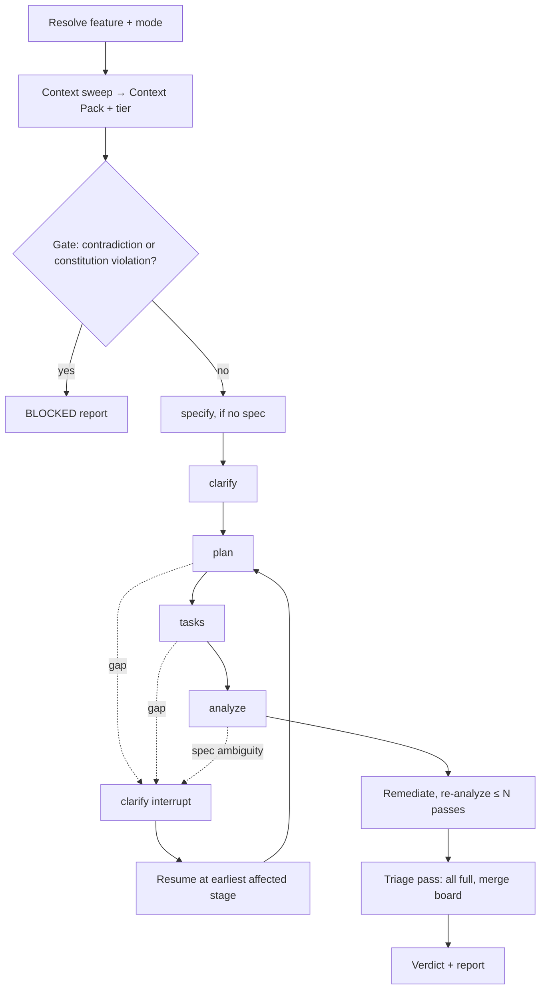

# Auto mode — guide

`speckit.deliberate.auto` runs the core Spec Kit flow
(specify → clarify → plan → tasks → analyze) in one gated pass, then writes a
readiness report. It is the only deliberate command that drives other
commands. The exact rules live in the command body; this page is the
operator's view.

## When to run it

| Moment | Say | Mode |
|---|---|---|
| Explore converged, no feature yet | "auto this feature" | `initial` — creates the feature via specify |
| Feature has some artifacts already | "auto this feature" | `initial` — adopts what exists, runs only missing stages, then analyze |
| After a recap, changing a decision | "auto: change DR-004 to event-driven" | `iterate` — supersede (after you confirm) and reconcile |
| Approving pending decisions | "auto: approve PD-3, DR-012" | `iterate` — re-check evidence and DR-worthiness, write or flip the DRs, apply the edits they unblocked |
| Before a review, after manual edits | "reconcile the docs for the next review" | `iterate` — delta sweep, clarify scan, analyze loop |

Mode is detected from the feature's report file and your input; force it
with `auto.mode`.

## Lifecycle

Every question a stage raises goes through one protocol: classify (spec gap,
DR, platform, skip) → rank P0/P1/P2 → resolve with evidence, a balanced
default, or leave open → write only what the approval rule allows. Ranks
during the run are provisional; before the verdict auto runs
`speckit.deliberate.triage` (`all full`) as a separate read-only pass and
merges its board, so uncertainties already in the tree — older Proposed DRs,
low-confidence DRs, fired Revisit Triggers, failing checklist gates, blocked
tasks — count too. A tree that could not be triaged is never `READY`.

## Evidence vs authority

| You configured | New DR with evidence | DR without evidence | Superseding an Accepted DR |
|---|---|---|---|
| `approval: queue` (default) | Queued in the report — no write | Queued in the report — no write | Waits for your confirmation |
| `approval: accept-evidenced` | Written `Accepted` | Queued in the report — no write | Waits for your confirmation |

Queued decisions get a stable `PD-N` id in `auto-report.md`; no DR file or
ledger row exists until you approve. Existing Proposed DRs keep their own
`DR-NNN`. Edits that depend on a pending decision are never applied.
"approve PD-…" in a later iterate run re-checks that the item is still
DR-worthy and its option still meets the evidence bar, then writes it through
record and applies what it blocked; a failed check leaves it pending with the
reason. "reject PD-…" drops it. A requested supersession is always queued
this way first; replying "yes" or "approve PD-…" is the confirmation.

Everything else triage finds — spec gaps, open markers, failing checklist
gates, blocked tasks — is listed under **Open items** with its owning
command. Open items count toward the verdict but cannot be approved.

## Gaps with little or no context

The sweep reports a **context tier** (`Rich` · `Partial` · `Sparse`). For a
gap with no evidence, auto picks the **balanced** option — best mix of
effort, cost, and reversibility among options that satisfy every constraint
— and tags it `[assumed]` where it lands. Defaults never count as evidence
and never become Accepted DRs.

Never defaulted: auth/privacy without a named authority and read path,
destructive operations and migrations, security boundaries, legal or
compliance calls, platform-scoped items, and any P0.

## Verdicts

| Verdict | Means | Next |
|---|---|---|
| `BLOCKED` | A pending P0, an awaited ADR handoff a stage needs, an unconfirmed supersession, an unresolved CRITICAL finding, or a gate | Clear the named blocker |
| `READY WITH PENDING DECISIONS` | No blocker; P1 decisions or assumptions await you | Approve or change them, then iterate |
| `READY` | Only P2 items, or none | `speckit.implement` — auto never runs it |

## Report file

`specs/NNN-*/auto-report.md` (`auto.report_file`). One `## Run N` section is
appended per run; earlier runs are never edited. Iterate mode reads the last
run to find pending items and assumptions.

## Configuration

All keys are optional; a config from an older version works unchanged.
Copy the `auto:` block from `config-template.yml` into
`deliberate-config.yml` to customize.

| Key | Default | Effect |
|---|---|---|
| `mode` | `auto` | `auto` detects; `initial` · `iterate` force |
| `run_specify` | `true` | `false` requires an existing spec |
| `report_file` | `auto-report.md` | Report path inside the feature dir |
| `sweep_depth` | `standard` | `quick` · `standard` · `deep` codebase breadth |
| `context_sources` | `[]` | Extra read-only paths for the sweep |
| `require_constitution` | `false` | `true` blocks when no constitution exists |
| `approval` | `queue` | `accept-evidenced` writes evidenced new DRs as Accepted |
| `default_policy` | `balanced` | `conservative` · `stop` (no defaults) |
| `defaultable_max_rank` | `P1` | Highest rank a default may fill |
| `mark_assumed` | `"[assumed]"` | Tag written next to defaulted content |
| `auto_remediate` | `true` | `false` reports remediations without editing |
| `clarify_max_interrupts` | `3` | Clarify interrupts per run |
| `analyze_max_passes` | `2` | Analyze → remediate passes per run |

## Boundaries

Auto writes only inside the feature directory (plus what specify creates).
It never edits the constitution, ADR logs, other features, or application
code, never commits, and never runs implement.
